<p align="center">
  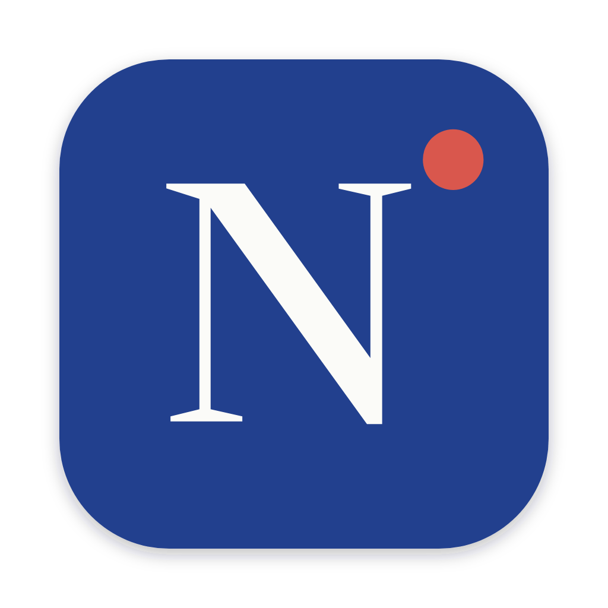
</p>

<h1 align="center">Notted</h1>

<p align="center">
  Record a meeting on your Mac. Get a summary and suggested tasks from your own Claude Code.
</p>

<p align="center">
  macOS 14+ on Apple silicon &nbsp;·&nbsp; Transcribes locally &nbsp;·&nbsp; Uses your Claude Code login &nbsp;·&nbsp; No API key
</p>

---

## What Notted does

Notted records a meeting on your Mac (your microphone and the system audio), transcribes it locally, asks your own Claude Code for a summary and task suggestions, and saves the meeting to your meetings archive in git when you say yes.

1. You record the meeting from the Notted window or from the menu bar.
2. Notted transcribes the audio on your Mac. The audio never leaves it.
3. Claude Code reads the transcript and writes a summary and suggested tasks, using the instructions in your archive.
4. Notted saves the meeting to your archive only after you say yes.
5. You accept or reject each suggestion with **Review suggestions**, or in the meeting's own Claude Code session.

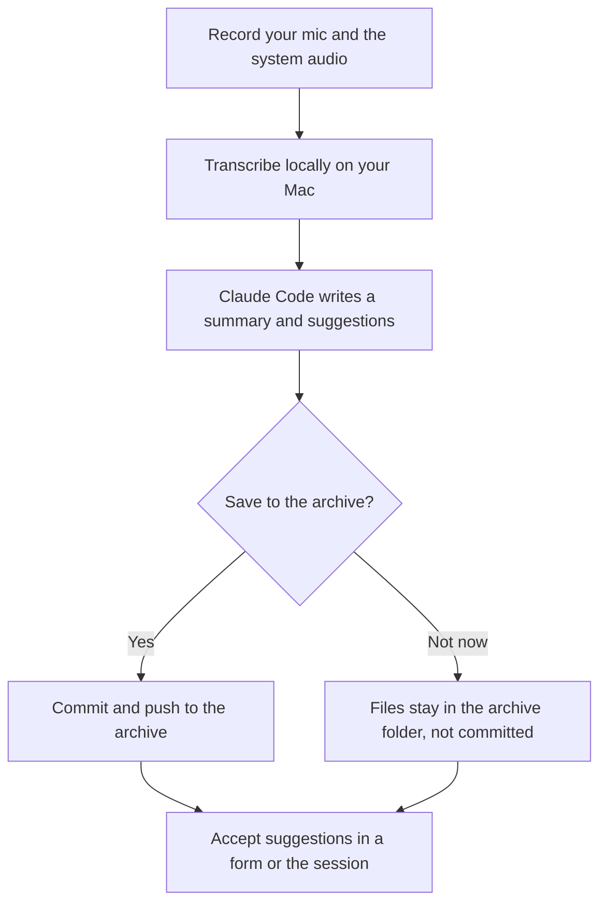

## How it looks

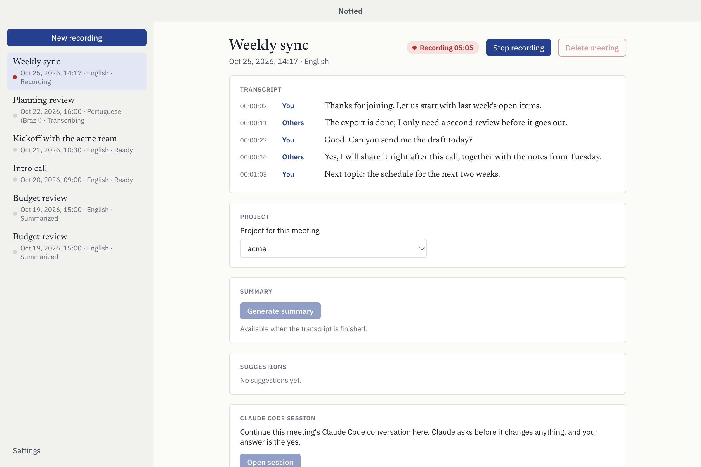

*Recording a meeting. The transcript fills in while you record, and your own lines are marked **You**.*

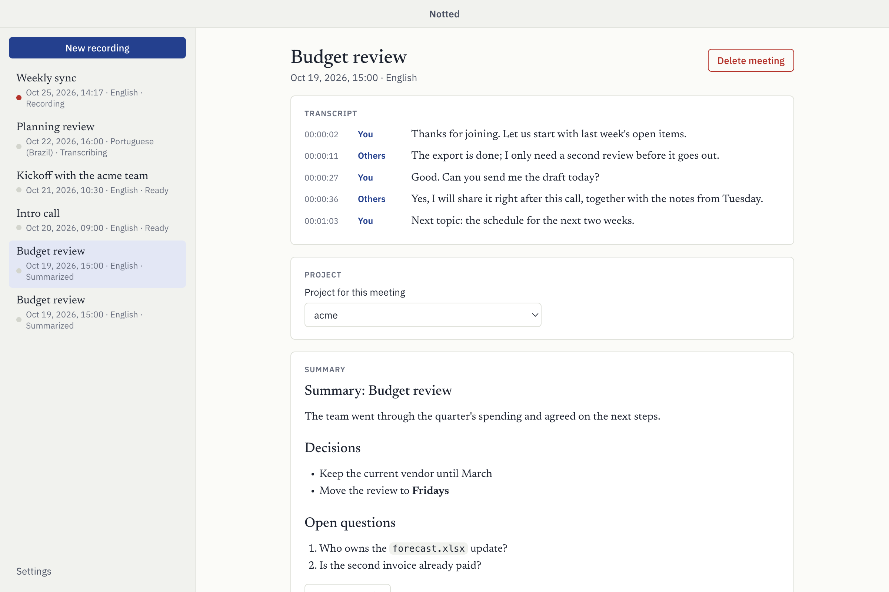

*A summarized meeting. Claude Code wrote the summary from the transcript and your instructions.*

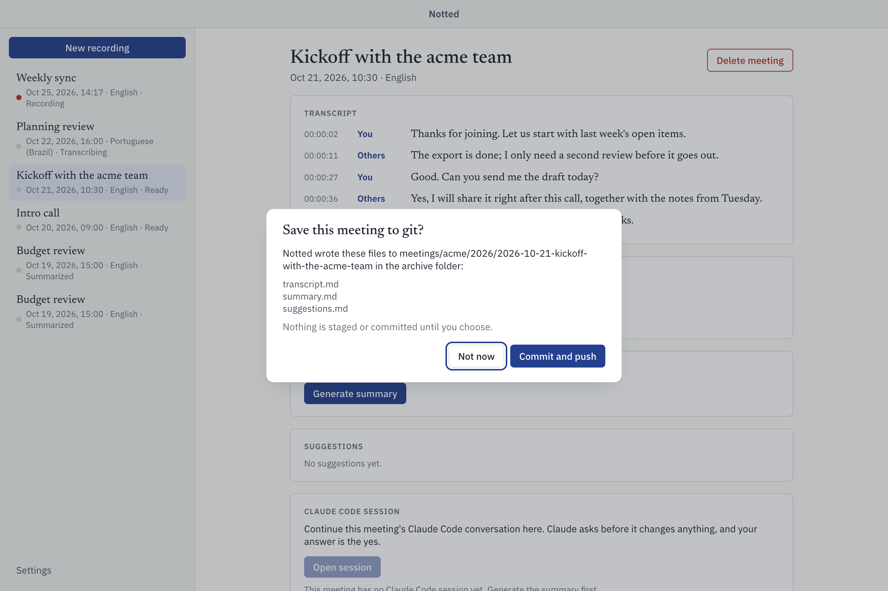

*The save dialog. Nothing is staged or committed until you choose.*

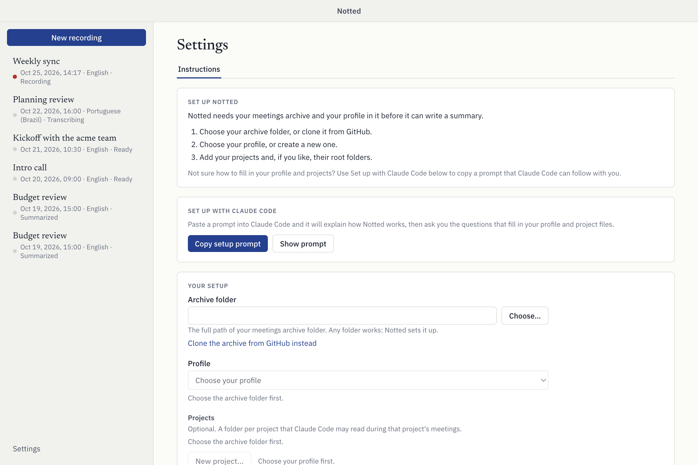

*First run. **Settings > Instructions** shows a checklist for the archive, your profile and your projects.*

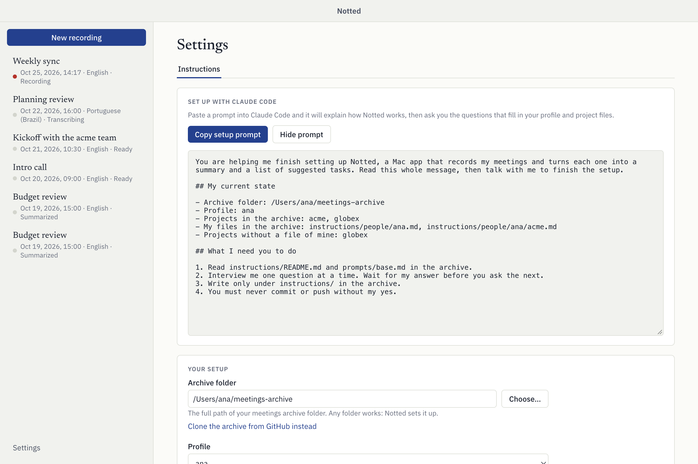

*The **Set up with Claude Code** card with the prompt shown. The screenshot uses a short sample; the real prompt is longer, explains how Notted works and lists what your own archive holds. **Copy setup prompt** copies it, and **Show prompt** lets you read it first.*

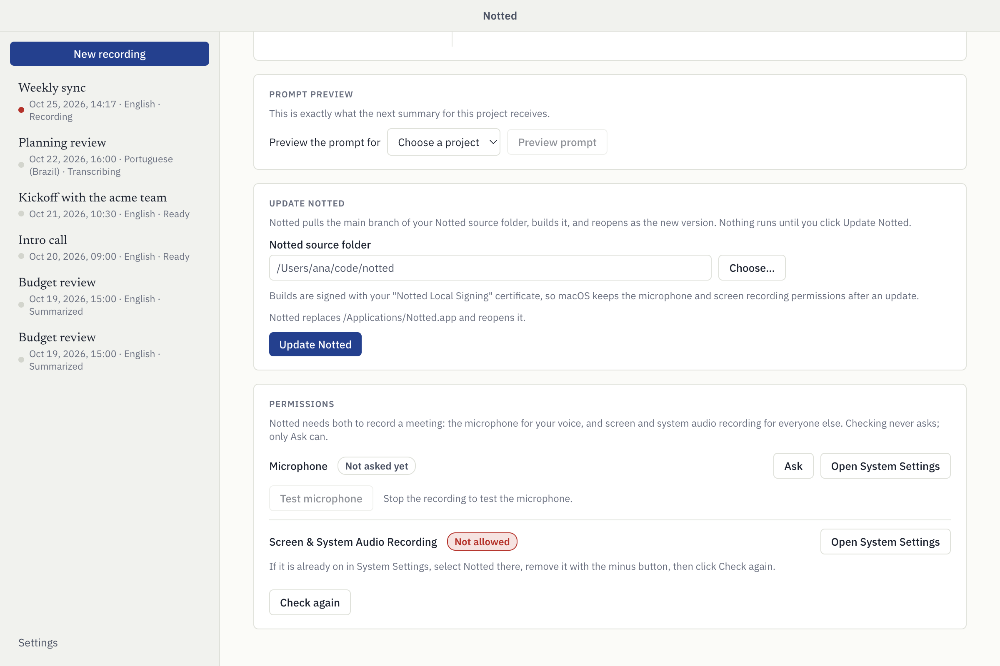

*The **Permissions** card shows the state of both permissions and links to System Settings.*

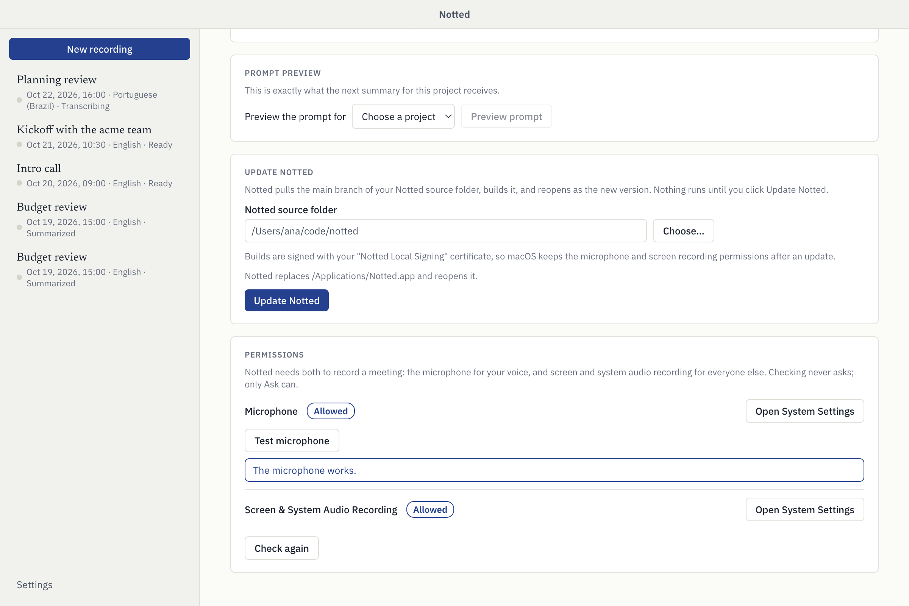

***Test microphone** listens for a moment and tells you whether the microphone hears anything.*

Notted follows your Mac's light or dark appearance:

| Light | Dark |
| --- | --- |
|  | 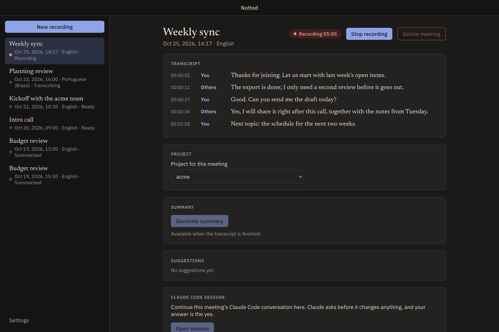 |
|  | 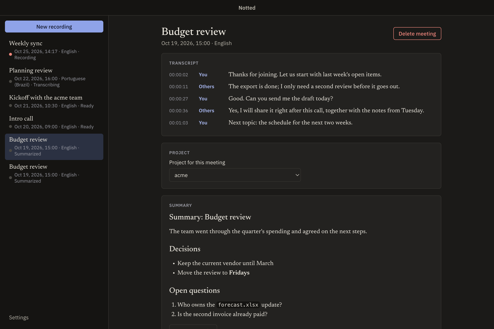 |

The menu bar menu is a native macOS menu, so it is not shown here. [Menu bar](#menu-bar) describes it.

## Install

```
git clone <your Notted repository address>
cd notted
make install
```

`make install` checks your Mac and the tools below, and tells you how to fix anything missing before it changes anything. If your keychain has no "Notted Local Signing" certificate, it creates one, and macOS asks for your login password once so it can trust the certificate for signing Notted. It then builds Notted, puts it in `/Applications`, and opens it. **Update Notted** then uses this clone as its source folder, until you choose another one in **Settings**.

### What you need

`make install` checks this list and stops with a fix for each missing item. A missing Claude Code only gives a warning, and the archive folder is not checked. If Go is installed and the Wails CLI is not, it installs Wails v2.12.0 for you.

| You need | How to get it |
| --- | --- |
| macOS 14 or later on Apple silicon | - |
| Go 1.26 or later | `brew install go`, or [go.dev/dl](https://go.dev/dl/) |
| The Wails CLI v2.12.0 | `make install` installs it; by hand: `go install github.com/wailsapp/wails/v2/cmd/wails@v2.12.0` |
| Node 20.19 or later (Node 24 recommended) | `brew install node`, or [nodejs.org](https://nodejs.org/) |
| Xcode Command Line Tools, which provide `swiftc` 6 and the macOS SDK | `xcode-select --install` |
| Claude Code installed and logged in, with `claude` on your login shell's `PATH` (aliases are not followed) | See [claude.com/claude-code](https://claude.com/claude-code) |
| A folder for your meetings archive: an empty folder, or a clone of your team's archive | You choose it in Settings. Notted sets it up the first time you choose it. |

### Build without installing

`make build` is for development: it builds `build/bin/Notted.app` and installs nothing. `make test` runs every check.

### First launch

The app is not notarized, so macOS may block the first open. Open System Settings > Privacy & Security and click **Open Anyway**.

Notted asks for the microphone and for Screen & System Audio Recording when you first record. After you grant screen recording, quit and reopen Notted. If your keychain has no "Notted Local Signing" certificate, every build is signed ad hoc with a new identity, and macOS asks for both permissions again after each build. See [Sign with your own certificate](#sign-with-your-own-certificate-once).

### Sign with your own certificate (once)

`make install` does this for you. To do it by hand, run `bash scripts/create-signing-identity.sh` once. It creates a self-signed code-signing
certificate named "Notted Local Signing" in your login keychain, and macOS asks for your login
password so it can trust that certificate for code signing. From then on, `make build` signs
with it and prints `sign-bundle: signing with "Notted Local Signing"`, so macOS keeps the
microphone and screen recording permissions across builds and updates. If macOS asks whether
codesign may use the key, click **Always Allow**. Without the certificate, `make build` signs ad
hoc and prints a note.

The certificate stays in your keychain and signs only the builds you make yourself. To remove
it, delete "Notted Local Signing" in Keychain Access.

## Set up

The first time you open Notted, it shows **Settings > Instructions** with a short checklist.

1. **Archive folder:** click **Choose…** and pick a folder for your meetings archive (an empty folder works), or
   click **Clone the archive from GitHub instead**, paste its address and choose where to put it.
   Notted runs your own git, with your own login.
2. **Profile:** choose yourself from the people in the archive, or choose **New profile…** to
   create your file from a short template.
3. **Projects:** every project in the archive gets a row. Click **Choose…** to give it a root
   folder that Claude Code may read during its meetings. **New project…** creates the project's
   file and your own file for it.

Every new file opens in the editor below, ready to fill in. You can also paste a full path into
any field and click **Save settings**.

### Let Claude Code help you fill in the files

Not sure how to fill in your profile and projects? The **Set up with Claude Code** card in
Settings has a **Copy setup prompt** button.

1. Click **Copy setup prompt**.
2. Paste what it copies into a Claude Code session.
3. Answer the questions. The prompt explains how Notted works, lists what your archive holds now, and tells Claude Code to ask
   you one question at a time and write your profile and project files under `instructions/`.

**Show prompt** lets you read it first. If the archive is not chosen yet, the prompt tells Claude
Code to send you back to Settings to choose or clone it first.

### Preview the prompt a summary receives

The **Prompt preview** card in Settings shows exactly what the next summary for a project receives. Choose a project under **Preview the prompt for**, then click **Preview prompt**.

### Delete a profile

To remove a teammate's profile, click **Delete a profile…** under **Profile**. Notted lists every
file it will delete and asks first. You cannot delete the profile you are using. A project row
shows **Create my file** when your own file for that project is missing.

Notted never commits these changes: deleting and creating files only changes the archive folder,
like any edit.

### Delete a project

To remove a project, click **Delete a project…** under **Projects**, then **Delete…** on its row. Notted lists what it deletes and asks first: the project's file, your own file for it, its `meetings/<key>/` folder in the archive, and its meetings in Notted. Meetings that were never saved to the archive are gone for good. Teammates' files for the project stay. A project cannot be deleted while one of its meetings is being recorded.

Notted then asks **Commit and push the deletion?** **Commit and push** commits only the removed files, with the message `project(<key>): delete`, and pushes them. **Not now** leaves the deletion in the archive folder, uncommitted. Everything that was committed before stays in the archive's git history.

## Use it

### Record a meeting

1. Click **New recording** in the window, or choose **Start recording** from the menu bar icon.
2. Give the meeting a **Title** and choose its **Language** (Portuguese (Brazil) or English), then click **Start recording**.
3. Click **Stop recording** when the meeting ends. Notted then transcribes the audio.

If Notted hears no sound from your microphone, it shows a warning during the recording. For example, a MacBook's built-in microphone is off while the lid is closed. Open the lid, or choose another input in System Settings > Sound > Input.

### Menu bar

Notted keeps its icon, the Notted N, in the menu bar for as long as it runs; a dot appears beside the N while a recording runs. Its menu starts and stops a recording (with the default title and the language of your latest meeting), opens the window, and quits. Closing the window only hides it: the icon, and any recording, keep going. Click the Dock icon or choose **Open Notted** to bring the window back. Choose **Quit Notted** (or press Cmd+Q) to quit; a recording in progress is stopped and kept.

### Summarize and save

1. When the transcript is finished, choose the meeting's project under **Project for this meeting**.
2. Click **Generate summary**. Claude Code writes the summary, then the suggestions.
3. Notted asks **Save this meeting to git?** and lists the files it wrote. Click **Commit and push** to save them, or **Not now** to keep them in the archive folder without committing.

### Accept suggestions

On a summarized meeting, click **Review suggestions** on the **Suggestions** card. Claude Code shows the suggestions as a form under **Waiting for you**: check the ones to accept and click **Send**. The unchecked ones are rejected. Claude Code then follows your accept instructions and asks you, in the same place, before it writes, commits or pushes anything. Each file edit and command comes to you as an **Allow** or **Deny** card. To skip those cards, switch on **Let Claude act without asking during reviews** in **Settings**, under **Suggestion reviews**. It is off by default. When it is on, Claude Code edits files and runs commands, git included, without asking you; the suggestions form, and any question your accept instructions ask, still come to you. With no instructions, accepting prints the task and does nothing else.

You can also do it in the terminal: the **Claude Code session** card continues the meeting's conversation in the app. Claude asks before it changes anything, and your answer is the yes. The review and the terminal session use the same conversation, so only one of them runs at a time.

### Forms

Claude Code can ask you something through Notted with its `ask` tool, in any session Notted starts. The form shows at the top of the meeting's page under **Waiting for you**, and the meeting gets a dot in the list. If you are on that meeting's page, Notted scrolls up to the form and puts the keyboard focus on it, unless you are typing in the session's terminal. If the Notted window is hidden, a notification appears; click it to open the meeting with the form in view. A form can hold text, a static HTML view (no scripts, no network), one choice, several choices, a text field and a yes-or-no question, plus a **Note**. **Not now** answers that you did not decide, and Claude does not act on it. One form per meeting is open at a time; the next one waits. Quitting Notted answers every open form with **Not now**.

### Delete a meeting

To delete a meeting, click **Delete meeting** on its page. Notted lists what it removes (the audio, the transcript, the summary and the suggestions) and asks first. It also answers the meeting's open forms with **Not now** and removes its session files. It removes only Notted's copy and leaves the meeting's folder in the archive as it is. A recording must be stopped first.

## How it works

| Piece | What it does |
| --- | --- |
| The app | A Go and [Wails](https://wails.io) app with a React window. It keeps the state of every meeting in SQLite. |
| `audiocap` | A small Swift helper in `helpers/audiocap`. It records your microphone and the system audio as two separate tracks, which is why the transcript tells your lines (**You**) from everyone else's (**Others**). |
| Whisper and Silero | Local speech models, run through sherpa-onnx. Notted transcribes on your Mac and downloads the models once. See [What Notted downloads](#what-notted-downloads). |
| SQLite and audio | `~/.notted/meetings.sqlite` and `~/.notted/audio/<meeting-id>/`. See [Your data](#your-data). |
| The archive | A git folder you own. It holds your instructions, the prompts and the saved meetings. `bin/meeting prompt --project <key>` in the archive builds the prompt for a project's meetings. |
| Claude Code | Notted runs your own `claude` headless for the summary and the suggestions, with your subscription and no API key. Each meeting also gets its own Claude Code session. |

### Instruction layers

For a meeting of project `<key>` run by profile `<p>`, the prompt is assembled from these files in the archive, in this order:

1. `prompts/base.md`
2. `instructions/projects/<key>.md`
3. `instructions/people/<p>.md`
4. `instructions/people/<p>/<key>.md` (if present)
5. `instructions/people/<p>.local.md` (if present, and ignored by git)

The base's non-negotiables win over every layer. Otherwise the more specific layer wins, except that the project file wins on facts about the project. No other project's file is ever loaded. The archive's `instructions/README.md` describes every file and its headings; Notted adds it to the archive the first time you choose the folder.

### Claude Code

Claude Code is the only model Notted uses, and it needs no API key: `ANTHROPIC_API_KEY` and `ANTHROPIC_AUTH_TOKEN` are removed before `claude` runs. The summary runs read-only (`Read Grep Glob`). Every `claude` Notted starts also gets Notted's own tool server (`--mcp-config`): the Notted app itself in `mcp` mode, which talks to the open app over a private socket in `~/.notted/run/`. In headless turns, such as the summary and **Review suggestions**, Claude Code's permission requests come to Notted as cards (**Allow** or **Deny**). With **Let Claude act without asking during reviews** on, Notted starts each **Review suggestions** turn in Claude Code's bypass-permissions mode, so it asks for no permission; only an ask rule in your own Claude Code settings still comes as a card. The summary and the embedded session never use that mode. In the embedded session, Claude Code's permission prompts stay in the terminal and wait for you.

### What Notted downloads

On first use per language, Notted downloads the Whisper model (about 640 MB for English `small.en`, about 564 MB for Portuguese `turbo`) and the Silero speech detector (0.6 MB) from the sherpa-onnx releases on GitHub (`https://github.com/k2-fsa/sherpa-onnx/releases`). It verifies each file by SHA-256 and stores it in `~/.notted/models`. This is the only download Notted makes itself; the `claude` program talks to Anthropic on its own. Notted also runs your own git, with your own login, against your own remotes: **Clone the archive from GitHub instead** runs `git clone`, **Commit and push** runs `git push`, and **Update Notted** runs `git pull`.

## Update Notted

Notted can update itself from your own clone of its source. If you installed with `make install`, that clone is already in use. Otherwise, in **Settings**, under **Update
Notted**, click **Choose…** and pick the folder of your Notted clone. **Update Notted** then:

1. checks that the clone is on `main` with no uncommitted changes, and stops if it is not;
2. runs `git pull --ff-only` on `main`, with your own git and your own login;
3. runs `make build` without the network (if an update adds dependencies, run `make build` once in Terminal first);
4. quits Notted, puts `build/bin/Notted.app` in place of the app you are running, and reopens it.

Nothing runs until you click **Update Notted**. A failed pull or build leaves your app as it was
and shows the output. The installer copies the new app next to the old one, swaps the two with
renames, and keeps the old copy until the new one has started. Its log is `~/.notted/update.log`.

## Permissions

Notted needs two permissions to record a meeting: the microphone for your voice, and Screen & System Audio Recording for everyone else. The **Permissions** card in **Settings** shows each one as **Allowed**, **Not allowed** or **Not asked yet**. **Ask** shows the macOS prompt, **Open System Settings** opens the right pane, and **Check again** reads the state again without asking. Click **Test microphone** to check that the microphone hears you. It is off while a recording runs.

macOS asks for the microphone and screen recording permissions again only when the app's signature changes. `make install` and **Update Notted** compare the signature of the installed app with the new one, and reset the two permissions only when they differ. With the "Notted Local Signing" certificate the signature stays the same across builds.

## Your data

Everything is under `~/.notted`: `meetings.sqlite`, `audio/<meeting-id>/`, `models/`, `run/` (the socket of Notted's tool server), `sessions/<meeting-id>/mcp.json` (how Claude Code starts that server for a meeting) and `update.log`. Audio never leaves the Mac and is never committed. The first time you choose a folder, Notted adds what the archive needs (bin/meeting, prompts/, instructions/, the meetings skill, a commit hook and the recording rules in .gitignore) and changes nothing already there. A folder that is not in a git repository gets git init; with no remote, meetings are committed on this Mac only. A meeting's files (`meeting.md`, `transcript.md`, `summary.md` and `suggestions.md`) go in only after you say yes.

## Troubleshooting

| Problem | What to do |
| --- | --- |
| Screen recording stays **Not allowed** after a rebuild | The signature changed, so macOS keeps the old permission against it. In System Settings > Privacy & Security > Screen & System Audio Recording, select Notted, remove it with the minus button, click **Check again**, then switch it on and reopen Notted. Create the signing certificate once to stop this. |
| The transcript has no lines from you, or a warning says the microphone recorded no sound | A MacBook's built-in microphone is off while the lid is closed. Open the lid, or choose another input in System Settings > Sound > Input. Then click **Test microphone** in Settings. |
| Summary fails and `claude` is not found | Notted looks for `claude` through your login shell, and it does not follow aliases. Make `command -v claude` work in a new Terminal window, then try again. |
| **Update Notted** stops before it pulls | The clone must be on `main` with no uncommitted changes. Check out `main`, commit or stash your changes, then try again. |
| `make install` stops with a list of missing items | Fix each item as the message says, then run `make install` again. |

## Development

- `make dev` starts the app with live reload.
- `make check` runs the source checks and the installer and signing tests. `make test` also runs the Go and frontend tests.
- `NOTTED_HOME` moves the data folder.
- `NOTTED_AUDIOCAP` points at a helper build during `wails dev`.
- `NOTTED_MODEL_MANIFEST` replaces the model manifest.
- The app icon's source is `build/appicon.svg`; `build/appicon.png` is its 1024 px render, which Wails turns into the app's icon file.

### Preview build and screenshots

The frontend has a preview build that runs in a browser with sample data. Open it at `?screen=<name>&theme=<light|dark>`; the screen names are in `frontend/src/preview/params.ts`. To retake the screenshots in this file:

1. Build the preview: `frontend/node_modules/.bin/vite build frontend --mode preview --outDir dist-preview --emptyOutDir`.
2. Serve `frontend/dist-preview` on a free local port, for example `python3 -m http.server 4791 --directory frontend/dist-preview --bind 127.0.0.1`.
3. Run `bash scripts/screenshots.sh <base-url>` with the address of that server. The script writes the PNG files in `docs/screenshots/`. It needs Google Chrome.

## Notices

Notted copies code from quant (MIT, Copyright (c) 2026 Luis Brienze). `NOTICE.md` lists the copied files.
